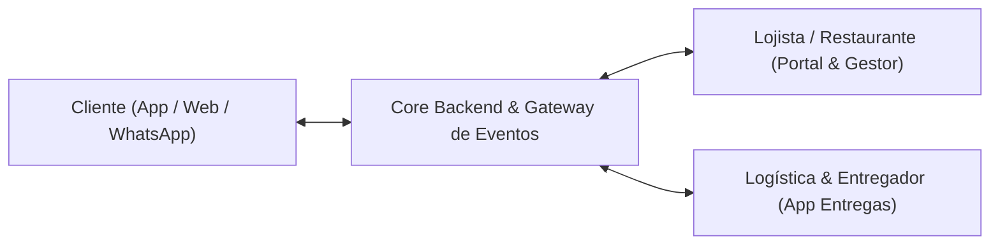

# Arquitetura e Engenharia Reversa do iFood (Modelo de Referência para Caraíva)

Este documento detalha o mapeamento completo da arquitetura do iFood obtido através dos comandos e ferramentas do **REA** (`rea-agents`) e das especificações do ecossistema de APIs (`merchant-api.ifood.com.br`), servindo como base técnica para a criação da plataforma de delivery de Caraíva.

---

## 1. Visão Geral dos 3 Pilares da Plataforma

O iFood opera através de um ecossistema dividido em 3 frentes interdependentes:



1. **Aplicativo do Cliente (Consumer):**
   - Geolocalização / Definição de endereço (No caso de Caraíva: Pontos de referência, Praias, Pousadas, Ruas de areia).
   - Catálogo com filtros (Abertos agora, Culinária, Taxa de entrega, Tempo estimado).
   - Cardápio interativo com personalização (Tamanho, Adicionais, Exclusão de ingredientes, Observações).
   - Sacola de compras e Checkout (Cupom, Taxa de serviço, Pagamento Instantâneo Pix com QR Code dinâmico).
   - Rastreamento em tempo real (Timeline: Confirmado -> Em Preparo -> Saiu para Entrega -> Entregue).

2. **Gestor de Pedidos do Restaurante (Merchant):**
   - Notificação sonora de novos pedidos em tempo real (WebSockets / Server-Sent Events / Long Polling).
   - Controle de status: Aceitar pedido -> Tempo de preparo -> Despachar pedido.
   - Gestão de Cardápio (Ativar/Desativar itens em estoque com 1 clique).
   - Horários de funcionamento e Pausas temporárias ("Cozinha cheia").

3. **Logística e Entregadores (Delivery):**
   - Alocação e despacho de pedidos.
   - Taxa de entrega calculada por setor geográfico.
   - Código de confirmação de entrega (PIN de 4 dígitos via SMS/Push para evitar fraudes).

---

## 2. Dicionário de Dados & Esquemas de API (Extraído das especificações iFood)

### A. Endpoints do Ciclo de Pedidos (`/order/v1.0`)
- `GET /order/v1.0/orders:polling`: Lojista consome novos eventos de pedidos a cada 30 segundos ou via WebSocket.
- `POST /order/v1.0/orders:acknowledgment`: Confirma o recebimento do evento no app do restaurante.
- `GET /order/v1.0/orders/{orderId}`: Detalhes completos do pedido, cliente, endereço e itens.
- `POST /order/v1.0/orders/{orderId}/confirm`: Restaurante aceita o pedido.
- `POST /order/v1.0/orders/{orderId}/readyToPickup`: Cozinha finalizou, pedido pronto para ser retirado.
- `POST /order/v1.0/orders/{orderId}/dispatch`: Entregador pegou e saiu para entrega.
- `POST /order/v1.0/orders/{orderId}/delivered`: Confirmação de entrega finalizada.

### B. Estrutura do Pedido (Payload JSON Modelo)
```json
{
  "orderId": "caraiva-ord-10029",
  "createdAt": "2026-10-15T12:00:00Z",
  "merchant": {
    "id": "rest-bar-do-porto",
    "name": "Bar do Porto Caraíva"
  },
  "customer": {
    "name": "Turista Visitante",
    "phone": "+5573999999999"
  },
  "delivery": {
    "mode": "LOCAL_COURIER",
    "deliveryAddress": {
      "formattedAddress": "Rua da Praia, Pousada Casa da Praia, Quarto 04",
      "reference": "Em frente ao campinho",
      "zone": "Praia"
    },
    "deliveryFee": 15.00,
    "courier": {
      "name": "Tiago Carroceiro / Bike",
      "phone": "+5573988888888"
    }
  },
  "items": [
    {
      "name": "Pastel de Arraia",
      "quantity": 2,
      "unitPrice": 22.00,
      "totalPrice": 44.00,
      "options": [
        { "name": "Molho de Pimenta da Casa", "price": 0.00 }
      ],
      "observations": "Bem frito e sequinho"
    }
  ],
  "payments": {
    "method": "PIX",
    "status": "PAID",
    "subtotal": 44.00,
    "deliveryFee": 15.00,
    "total": 59.00
  },
  "status": "CONFIRMED"
}
```

---

## 3. Adaptação Específica para Caraíva (O Diferencial Competitivo)

Por que o iFood padrão não funciona bem em Caraíva:
1. **Sem CEP por rua ou número oficial:** O GPS padrão do Google Maps erra nas vielas de areia.
   - *Solução:* Mapeamento de Zonas (Beira-Rio, Praia, Centro/Igreja, Xandó, Aldeia) + Nome da Pousada / Ponto de Referência.
2. **Modal de Transporte Diferenciado:** Não existem motos ou carros particulares dentro da vila.
   - *Solução:* Entregas a pé, bicicleta cargueira ou carroça/quadriciclo credenciado.
3. **Oscilação de Conectividade:** A internet móvel pode oscilar na alta temporada.
   - *Solução:* Arquitetura PWA Offline-first + Notificações diretas e espelhamento no WhatsApp (Webhooks para WhatsApp Business).
4. **Pagamento Direto via Pix:** Turistas e pousadas usam quase 100% Pix imediato no balcão.
   - *Solução:* Integração direta com gateway de Pix (Mercado Pago, Efí/Gerencianet ou Asaas) gerando QR Code dinâmico que aprova o pedido em 2 segundos.
