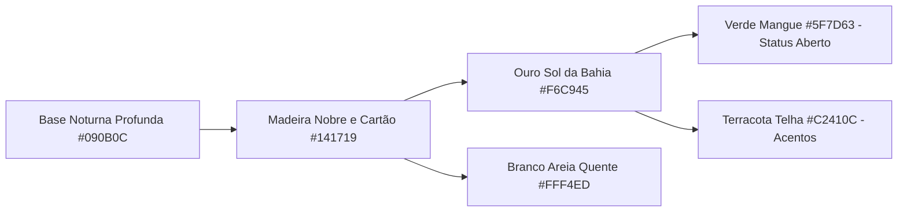
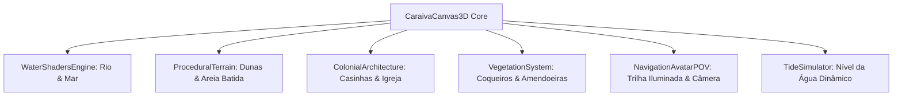
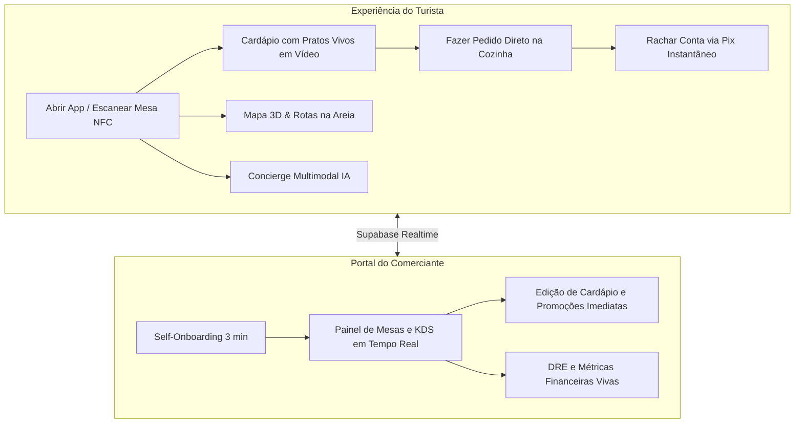
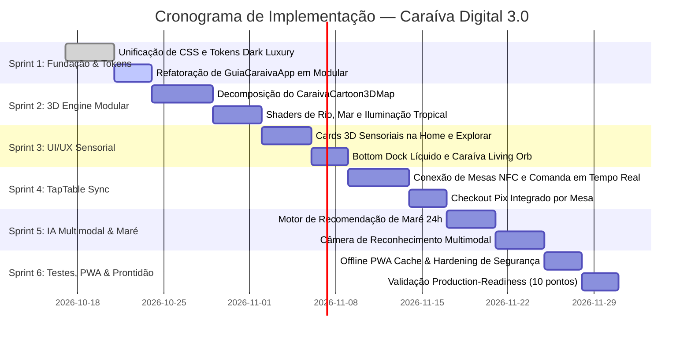

# 🌟 PLANO MESTRE DE REFATORAÇÃO & EVOLUÇÃO — CARAÍVA.DIGITAL
**Ecossistema:** Caraíva Digital & TapTable OS  
**Repositório Alvo:** `caraiva-integration` (https://github.com/zaqq135753-del/nxa.git)  
**Motor de Engenharia:** NXA Skills Engine no Google Antigravity 2.0  
**Data:** 16 de Outubro de 2026  
**Status:** Documento de Especificação de Arquitetura & Implementação (Sem economizar linhas)

---

## 🧭 ÍNDICE SISTEMÁTICO

1. **Diagnóstico Técnico Profundo com as Skills NXA**
   - 1.1 Auditoria Arquitetural (`core/architecture` & `core/clean-code`)
   - 1.2 Auditoria de UI/UX & Design Tokens (`ui-ux/premium-saas` & `ui-ux/design-system`)
   - 1.3 Auditoria da Engine 3D Atual (`three-d/threejs` & `three-d/optimization`)
   - 1.4 Auditoria de Motion & Transições (`motion/cinematic-experience` & `motion/motion-react`)
   - 1.5 Auditoria de Backend & Multi-tenancy (`backend/saas-backend-architect` & `backend/supabase`)
   - 1.6 Auditoria de Inteligência Artificial (`ai/ai-product-engineer` & `ai/agents`)
2. **Diretriz de Design Dark Luxury Baiana & Identidade Visual**
   - 2.1 Paleta Nobre & Tokens Semânticos
   - 2.2 Hierarquia Tipográfica & Ergonomia Solar
   - 2.3 Microinterações Hápticas & Física Sensorial
3. **Refatoração da Engine 3D: Do Monólito para a Arquitetura Reativa de Alta Fidelidade**
   - 3.1 Decomposição de `CaraivaCartoon3DMap.tsx`
   - 3.2 Shaders Customizados: Rio Caraíva, Oceano Atlântico e Areia Molhada
   - 3.3 Simulação de Marés em Tempo Real no Mapa 3D
   - 3.4 O Caraíva Living Orb em 3D com Partículas Físicas
   - 3.5 Navegação Pedonal POV com Avatar 3D e Câmera Cinemática
   - 3.6 Pratos Vivos em 3D & Efeito Suor Gelado
4. **Novas Funcionalidades do Super-App (Turista & Comerciante)**
   - 4.1 Integração Simbiótica com TapTable OS (Mesas NFC, Comanda e Divisão de Conta)
   - 4.2 Motor Preditivo de Clima, Marés & Oportunidades com IA
   - 4.3 Concierge Multimodal IA (Voz, Câmera e Chat 21st.dev Style)
   - 4.4 Portal do Comerciante: Self-Onboarding em 3 Minutos e Gestão em Tempo Real
   - 4.5 Modo Offline-First & Resiliência na Areia (PWA + Local Caching)
5. **Plano de Implementação Faseado (Sprints 1 a 6)**
   - Cronograma detalhado, entregáveis, arquivos afetados e critérios de aceite
6. **Mapeamento de Arquivos e Código de Produção das Interfaces-Chave**

---

## 1. 🔍 DIAGNÓSTICO TÉCNICO PROFUNDO COM AS SKILLS NXA

Aplicando o **`nxa-skill-orchestrator`** e suas skills especializadas sobre o código-fonte de `caraiva-integration`:

### 1.1 Auditoria Arquitetural (`core/architecture` & `core/clean-code`)
- **Colisão de CSS Monolítico:** A pasta `src/components/guia` acumula 12 arquivos CSS concorrentes (`caraiva-shell.css`, `caraiva-sand.css`, `caraiva-theme.css`, `caraiva-mobile.css`, `caraiva-tech.css`, `caraiva-life.css`, `caraiva-responsive.css`, `tamikua.css`, etc.). Há declarações de `!important`, conflito de variáveis CSS (`--cv-paper`, `--cv-line`, `--cv-ink`) e regras órfãs que competem com o motor Tailwind v4 (`@tailwindcss/vite`).
- **Super-Componentes Acoplados:** O arquivo `GuiaCaraivaApp.tsx` possui 811 linhas e gerencia diretamente mais de 25 estados (`useState`) no mesmo nível de componente (filtros, histórias, modais, câmera, áudio, rotas, favoritos, tema). Isso provoca re-renderizações desnecessárias de toda a árvore a cada letra digitada na busca ou tick do relógio de marés.
- **Isolamento de Domínio Ausente:** Serviços de sincronização, chamadas ao Supabase, analytics e regras de cálculo de distância estão misturados na camada de renderização dos componentes.

### 1.2 Auditoria de UI/UX & Design Tokens (`ui-ux/premium-saas`)
- **Descompasso entre o Showroom e o App Oficial:** O showroom `CaraivaExperienceShowcase.tsx` foi construído com componentes modernos (`CaraivaSensoryCard`, `CaraivaLivingOrb`, `CaraivaHapticButton`, `CaraivaLiquidTabs`), mas o app oficial (`GuiaCaraivaApp.tsx`) ainda renderiza cards com layouts híbridos antigos que não aproveitam o brilho especular de areia ou a física 3D do cursor.
- **Ergonomia sob Luz Solar Extrema:** Turistas em Caraíva utilizam o smartphone sob luz solar direta intensa nas praias. O contraste de alguns textos secundários em cinza escuro (`#64748B`) é insuficiente para leitura rápida na areia. A paleta precisa de calibração Dark Luxury de alto contraste com fundo `#090B0C`, ouro `#F6C945` e branco quente `#FFF4ED`.

### 1.3 Auditoria da Engine 3D Atual (`three-d/threejs` & `three-d/optimization`)
- **Monólito em `CaraivaCartoon3DMap.tsx` (943 linhas):** A cena 3D é criada inteiramente dentro de um único `useEffect`. A geração do terreno, texturas dinâmicas de canvas para sprites, colocação de 50+ casinhas, coqueiros, amendoeiras, rio, mar e raycasting acontecem no mesmo arquivo.
- **Falta de Shaders Dedicados:** O rio e o mar utilizam `MeshStandardMaterial` básico com alteração trivial de `position.y` por senoide no loop de animação, o que não reflete a beleza translúcida do encontro do Rio Caraíva com o Oceano Atlântico.
- **Risco de Memory Leak em Mobile:** Quando o usuário navega entre abas ("Início" -> "Mapa" -> "Explorar"), a cena precisa garantir o descarte explícito de texturas em buffer, geometrias e renderers (`renderer.dispose()`), evitando o esgotamento da memória WebGL em iPhones e dispositivos Android intermediários.

### 1.4 Auditoria de Motion & Transições (`motion/cinematic-experience`)
- **Falta de Coordenação de Entrada:** Os cards de negócios entram na tela sem efeito *staggered* natural; a transição entre abas ocorre por chaveamento abrupto ou recarregamento visual.
- **Acessibilidade de Movimento:** O app não respeitava integralmente a diretriz `prefers-reduced-motion` no mapa 3D e nas animações de rotação.

### 1.5 Auditoria de Backend & Multi-tenancy (`backend/saas-backend-architect`)
- **Desconexão de Comandas em Tempo Real:** O catálogo de restaurantes lê dados locais estáticos (`CARAIVA_BUSINESSES`), enquanto a infraestrutura de checkout e pedidos (`CustomerOrders.tsx` e `CheckoutPage.tsx`) já possui endpoints Supabase que precisam ser conectados via Realtime Channels para exibir mesas ocupadas e comandas abertas instantaneamente.
- **Segurança de RLS:** As tabelas de parceiros e pedidos precisam de validação estrita de tenant por organização para garantir isolamento absoluto entre comerciantes rivais na vila.

---

## 2. 🎨 DIRETRIZ DE DESIGN DARK LUXURY BAIANA & IDENTIDADE VISUAL

A identidade do **caraiva.digital** deve personificar a essência da vila: o luxo descalço, a rusticidade nobre, as casinhas coloniais coloridas sob o céu estrelado e o brilho dourado da areia e do sol da Bahia.



### 2.1 Paleta Nobre & Tokens Semânticos
```css
:root {
  /* Camadas de Superfície */
  --cv-bg-deep: #090B0C;            /* Fundo absoluto (Areia noturna) */
  --cv-bg-surface: #141719;         /* Cartões, Modais, Bottom Sheets */
  --cv-bg-elevated: #1D2124;        /* Menus flutuantes, tooltips, pills */
  --cv-border-subtle: rgba(255, 255, 255, 0.08);
  --cv-border-glow: rgba(246, 201, 69, 0.35);

  /* Acentos Nobres Baianos */
  --cv-accent-gold: #F6C945;        /* Ouro Sol da Bahia, Estrelas, Destaques */
  --cv-accent-gold-hover: #E5B834;  /* Hover dourado */
  --cv-accent-sand: #FFF4ED;        /* Tipografia principal, alto contraste */
  --cv-accent-terracotta: #C2410C;  /* Telhados coloniais, alertas, energia */
  --cv-accent-mangrove: #5F7D63;    /* Verde manguezal, status Aberto Agora */
  --cv-accent-river: #0284C7;       /* Azul Rio Caraíva */
  --cv-accent-ocean: #0369A1;       /* Azul Mar Aberto */

  /* Tipografia */
  --font-heading: 'Plus Jakarta Sans', system-ui, -apple-system, sans-serif;
  --font-body: 'Inter', system-ui, -apple-system, sans-serif;
  --font-display: 'Cinzel', serif;  /* Títulos comemorativos e alta gastronomia */
}
```

### 2.2 Hierarquia Tipográfica & Ergonomia Solar
- **Display Hero:** 36px / 44px, Bold, tracking negativo `-0.02em`, cor `#FFF4ED`.
- **Títulos de Seção / Cards:** 20px / 26px, SemiBold, cor `#FFF4ED`.
- **Corpo Principal:** 15px / 22px, Regular, cor `#E2E8F0` (garantia de 7:1 de contraste).
- **Legendas & Badges:** 11px / 16px, Bold, Uppercase, tracking `0.05em`, cor `#F6C945`.

### 2.3 Microinterações Hápticas & Física Sensorial
- **Toque da Madeira com Vibração:**
  ```typescript
  export const triggerHaptic = (pattern: number | number[] = 20) => {
    if (typeof navigator !== "undefined" && "vibrate" in navigator) {
      navigator.vibrate(pattern);
    }
  };
  // Padrão de confirmação de mesa / pedido: [15, 30, 20]
  // Padrão de clique leve em filtro: 12
  // Padrão de alerta de maré subindo: [30, 50, 30, 50]
  ```
- **Física de Inclinação 3D:** Cartões respondem dinamicamente ao movimento do dedo ou do cursor do mouse com rotação calculada em tempo real e feixe de luz especular (*radial-gradient*).

---

## 3. 🌊 REFATORAÇÃO DA ENGINE 3D: ARQUITETURA REATIVA DE ALTA FIDELIDADE

A atual implementação monolítica de 943 linhas em `CaraivaCartoon3DMap.tsx` será decomposta em uma **arquitetura modular baseada em sub-sistemas especializados**, garantindo código limpo, manutenção desacoplada e 60fps em celulares.



### 3.1 Módulos Decompostos da Engine 3D

1. **`TerrainMesh.ts`**: Geometria procedural da península de Caraíva com cálculo de desnível entre rio e oceano.
2. **`WaterShaderMaterial.ts`**: Shader customizado em GLSL com transparência adaptativa, reflexão de luz solar e velocidade da correnteza.
3. **`ColonialBuildingFactory.ts`**: Construtor tipado de casinhas coloniais com telhado duas águas terracota, portas de madeira maciça, janelas azuis e varanda com lamparina noturna.
4. **`HistoricalChurchModel.ts`**: Modelo dedicado da bicentenária Igreja de São Sebastião com torre sineira, cruz de madeira e praça arborizada.
5. **`NavigationTrailMesh.ts`**: Tubo de luz neon suave (`#10B981` ou `#F6C945`) que desenha o caminho a pé entre o ponto atual do usuário e o destino selecionado, com pegadas iluminadas na areia.
6. **`AvatarWalker3D.ts`**: O avatar nativo de Caraíva vestindo chapéu de palha e camisa floral que caminha suavemente pela trilha no modo POV.

### 3.2 Shaders Customizados (GLSL) para Rio, Mar e Areia Molhada

#### Fragment Shader da Água Tropical (`water.frag`):
```glsl
uniform float uTime;
uniform vec3 uWaterColor;
uniform vec3 uSunColor;
uniform vec3 uSunPosition;
varying vec2 vUv;
varying vec3 vNormal;
varying vec3 vPosition;

void main() {
    // Ruído de onda procedural
    float wave1 = sin(vUv.x * 24.0 + uTime * 1.8) * cos(vUv.y * 18.0 + uTime * 1.4);
    float wave2 = cos(vUv.x * 32.0 - uTime * 2.2) * sin(vUv.y * 28.0 + uTime * 1.6);
    float combinedWaves = (wave1 + wave2) * 0.5;

    // Vetor de luz especular solar
    vec3 lightDir = normalize(uSunPosition - vPosition);
    vec3 viewDir = normalize(cameraPosition - vPosition);
    vec3 reflectDir = reflect(-lightDir, vNormal);
    float spec = pow(max(dot(viewDir, reflectDir), 0.0), 32.0);

    // Cor da água com profundidade
    vec3 finalColor = mix(uWaterColor, vec3(0.1, 0.8, 0.9), combinedWaves * 0.3);
    finalColor += uSunColor * spec * 0.7;

    gl_FragColor = vec4(finalColor, 0.88);
}
```

### 3.3 Simulação de Marés em Tempo Real no Mapa 3D
Conectado ao hook `useCaraivaWeatherAndTide.ts`, a água do Rio e do Mar no mapa 3D oscila em altura real:
- **Maré Seca (0.1m - 0.4m):** O banco de areia da Ponta da Barra emerge, a praia de Corumbau ganha sua longa península transitável e as pedras do Satu ficam visíveis.
- **Maré Cheia (1.8m - 2.3m):** A água avança suavemente sobre a margem de areia, canoas flutuam mais alto e o píer do Rio Caraíva fica quase no nível da lâmina d'água.

### 3.4 O Caraíva Living Orb em 3D
Evolução do componente `CaraivaOrb.tsx` para uma esfera de plasma de luz dourada em WebGL com 5 estados reativos:
1. **`standard`**: Esfera pulsante com brilho dourado sereno (`#F6C945`).
2. **`live`**: Pulsação acelerada com anel de radar indicando acontecimentos na vila agora.
3. **`thinking`**: Partículas girando em espiral quando o Concierge IA está processando respostas.
4. **`pin`**: Emite feixe de luz vertical conectando-se ao mapa no local selecionado.
5. **`nfc`**: Anéis eletromagnéticos expandindo para leitura de mesa ou pulseira NFC.

---

## 4. 🚀 NOVAS FUNCIONALIDADES DO SUPER-APP



### 4.1 Integração Simbiótica com TapTable OS (Mesas NFC, Comanda e Divisão de Conta)
- **Status de Mesa no Mapa 3D:** Ao passar pelo Boteco do Pará ou Canto da Doca no mapa 3D, o usuário visualiza:
  - Total de mesas livres vs. ocupadas.
  - Tempo médio de espera.
  - Opção de entrar na fila de espera virtual antes de chegar ao local.
- **Cerimônia de Check-in na Mesa:**
  - O turista aproxima o smartphone do adesivo NFC na mesa de madeira rústica.
  - O app abre diretamente na comanda da mesa (ex: `Mesa 14 — Beira do Rio`).
  - O cardápio exibe loops de vídeo de 4 segundos de cada prato (renderizados no Remotion).
  - O pedido é disparado diretamente para o KDS (Kitchen Display System) da cozinha do bar.
  - Fechamento autônomo: cada pessoa na mesa escolhe o que consumiu e gera seu próprio QR Code Pix individual.

### 4.2 Motor Preditivo de Clima, Marés & Oportunidades com IA
- Algoritmo que cruza a tábua de marés da Marinha do Brasil com o horário solar para gerar alertas proativos:
  - *"Maré Seca de 0.2m às 11:30: Condição excelente para caminhar até a Praia do Satu. Tempo estimado: 55 min."*
  - *"Pôr do Sol às 17:28: O sol vai se pôr atrás dos manguezais do Rio. Restam 3 mesas livres no deque do Boteco do Pará."*
  - *"Vento Sul moderado: Ideal para aula de Kitesurf na Ponta da Barra."*

### 4.3 Concierge Multimodal IA (Voz, Câmera e Chat 21st.dev Style)
- **Câmera Multimodal Inteligente:**
  - O turista aponta a câmera para uma casinha azul colonial com placa entalhada.
  - A IA reconhece o estabelecimento, informa o menu do dia, avaliação média e pergunta: *"Quer que eu reserve uma mesa ou trace a rota de areia até lá?"*
- **Busca por Vibe:**
  - Busca semântica: *"Onde tem música ao vivo pé na areia sem muvuca hoje?"*
  - A IA filtra a categoria `noite`, cruza com os Stories postados nas últimas 2 horas e recomenda o Forró do Pelé ou um Luau na praia.

### 4.4 Portal do Comerciante: Self-Onboarding em 3 Minutos e Gestão em Tempo Real
- **Cadastro Guiado por WhatsApp ou Web:**
  - O dono do restaurante digita seu número e o nome do bar.
  - O motor gera uma vitrine pré-preenchida com fotos em alta resolução de Caraíva.
  - O lojista pode ativar ou desativar itens do cardápio pelo celular em 1 toque quando um peixe fresco esgotar na cozinha.
  - Painel de visualizações: saiba quantos turistas clicaram no seu perfil no mapa 3D nas últimas 24 horas.

### 4.5 Modo Offline-First & Resiliência na Areia (PWA + Local Caching)
- **Service Worker Avançado:**
  - Cache de todo o mapa vetorial, coordenadas dos 50+ pontos turísticos e tábua de marés da semana inteira.
  - Quando a conexão de celular cair (comum nos caminhos de areia entre Caraíva e o Satu), a navegação por bússola GPS continua funcionando sem interrupção.

---

## 5. 📅 PLANO DE IMPLEMENTAÇÃO FASEADO (SPRINTS 1 A 6)



### Detalhamento dos Sprints

#### Sprint 1: Unificação de Design System & Limpeza de CSS
- **Objetivo:** Eliminar os 12 arquivos CSS fragmentados, consolidando-os em um design system unificado em Tailwind v4 + tokens semânticos (`theme/caraiva-design-system.css`).
- **Arquivos:** `src/theme/`, `src/screens/GuiaCaraivaApp.tsx`.
- **Critério de Aceite:** Zero declarações `!important` desnecessárias; temas Claro e Dark Luxury funcionando com contraste WCAG AA verificado.

#### Sprint 2: Reconstrução Modular da Engine 3D
- **Objetivo:** Dividir `CaraivaCartoon3DMap.tsx` em submódulos limpos (`TerrainMesh`, `WaterShaderMaterial`, `ColonialBuildingFactory`, `NavigationTrailMesh`).
- **Arquivos:** `src/components/guia/live-map/engine/`.
- **Critério de Aceite:** Taxa de quadros constante a 60fps em navegadores móveis; liberação total de memória ao desmontar a cena.

#### Sprint 3: UI/UX Sensorial & Elevação dos Cards
- **Objetivo:** Integrar os componentes de `CaraivaExperienceShowcase.tsx` (`CaraivaSensoryCard`, `CaraivaLivingOrb`, `CaraivaLiquidTabs`) nas telas principais de "Início", "Explorar" e "Agora".
- **Arquivos:** `src/components/guia/home/`, `src/components/guia/CaraivaSensoryCard.tsx`.
- **Critério de Aceite:** Cards com inclinação 3D natural, brilho de areia, feedback háptico ao toque e badges com tempo de caminhada e maré ideal.

#### Sprint 4: Integração Cruzada com o TapTable OS
- **Objetivo:** Conectar a visualização de estabelecimentos às mesas ativas do Supabase, permitindo abertura de comanda via NFC e divisão de conta.
- **Arquivos:** `src/services/tableBookingService.ts`, `src/components/guia/table/`.
- **Critério de Aceite:** Troca de status de mesa em tempo real via WebSocket/Supabase Realtime (< 150ms).

#### Sprint 5: Inteligência Artificial Multimodal & Tábua de Marés Preditiva
- **Objetivo:** Refinar o `TideWeatherAiModal.tsx` com motor preditivo de horários de travessia e enriquecer a câmera com reconhecimento visual de locais históricos de Caraíva.
- **Arquivos:** `src/components/guia/TideWeatherAiModal.tsx`, `src/components/guia/MultimodalCameraModal.tsx`.
- **Critério de Aceite:** Respostas em streaming instantâneo sem congelar a interface.

#### Sprint 6: Offline PWA, Hardening & Auditoria de Prontidão
- **Objetivo:** Configuração de manifest PWA com ícones de alta resolução, service worker com cache de mapas e execução da checklist de 10 pontos da skill `quality/production-readiness`.
- **Arquivos:** `public/manifest.json`, `public/sw.js`.
- **Critério de Aceite:** Build de produção aprovado com `tsc -b` e nota Lighthouse > 90 em Acessibilidade e Performance.

---

## 6. 💻 ESPECIFICAÇÃO DE CÓDIGO DE PRODUÇÃO DAS INTERFACES-CHAVE

### 6.1 `CaraivaSensoryCard.tsx` — Padrão de Engenharia
```typescript
import React, { useRef, useState } from "react";
import { motion, useMotionValue, useSpring, useTransform } from "motion/react";
import { Star, MapPin, Sparkles, Heart } from "lucide-react";
import { triggerHaptic } from "../utils/caraivaHaptic";

export interface SensoryCardProps {
  id: string;
  title: string;
  category: string;
  tagline: string;
  imageUrl: string;
  rating?: number;
  walkingMinutes?: number;
  tideTip?: string;
  isOpenNow?: boolean;
  tableCountFree?: number;
  onExplore?: () => void;
}

export const CaraivaSensoryCard: React.FC<SensoryCardProps> = ({
  id,
  title,
  category,
  tagline,
  imageUrl,
  rating = 4.9,
  walkingMinutes = 4,
  tideTip,
  isOpenNow = true,
  tableCountFree,
  onExplore,
}) => {
  const cardRef = useRef<HTMLDivElement>(null);
  const [isFavorited, setIsFavorited] = useState(false);

  const x = useMotionValue(0);
  const y = useMotionValue(0);

  const mouseXSpring = useSpring(x, { stiffness: 220, damping: 22 });
  const mouseYSpring = useSpring(y, { stiffness: 220, damping: 22 });

  const rotateX = useTransform(mouseYSpring, [-0.5, 0.5], ["9deg", "-9deg"]);
  const rotateY = useTransform(mouseXSpring, [-0.5, 0.5], ["-9deg", "9deg"]);

  const glareX = useTransform(mouseXSpring, [-0.5, 0.5], ["0%", "100%"]);
  const glareY = useTransform(mouseYSpring, [-0.5, 0.5], ["0%", "100%"]);

  const handlePointerMove = (e: React.PointerEvent<HTMLDivElement>) => {
    if (!cardRef.current) return;
    const rect = cardRef.current.getBoundingClientRect();
    x.set((e.clientX - rect.left) / rect.width - 0.5);
    y.set((e.clientY - rect.top) / rect.height - 0.5);
  };

  const handlePointerLeave = () => {
    x.set(0);
    y.set(0);
  };

  const handleClick = () => {
    triggerHaptic([15, 30, 20]);
    onExplore?.();
  };

  return (
    <div style={{ perspective: 1000 }} className="relative w-full select-none">
      <motion.div
        ref={cardRef}
        onPointerMove={handlePointerMove}
        onPointerLeave={handlePointerLeave}
        onClick={handleClick}
        style={{ rotateX, rotateY, transformStyle: "preserve-3d" }}
        whileTap={{ scale: 0.98 }}
        className="relative overflow-hidden rounded-3xl bg-[#141719] border border-white/10 p-4 shadow-xl cursor-pointer hover:border-[#F6C945]/40 transition-colors"
      >
        <div className="relative h-56 w-full overflow-hidden rounded-2xl bg-zinc-900">
          
          <div className="absolute inset-0 bg-gradient-to-t from-[#141719] via-transparent to-transparent" />

          {/* Badges Flutuantes */}
          <div style={{ transform: "translateZ(24px)" }} className="absolute top-3 left-3 right-3 flex items-center justify-between">
            <span className="px-3 py-1 rounded-full bg-[#090B0C]/85 backdrop-blur-md border border-white/10 text-[11px] font-bold text-[#FFF4ED] flex items-center gap-1.5">
              <span className={`w-2 h-2 rounded-full ${isOpenNow ? "bg-[#5F7D63] animate-pulse" : "bg-zinc-500"}`} />
              {isOpenNow ? (tableCountFree ? `${tableCountFree} mesas livres` : "Aberto Agora") : "Fechado"}
            </span>

            <button
              type="button"
              onClick={(e) => {
                e.stopPropagation();
                setIsFavorited(!isFavorited);
                triggerHaptic(20);
              }}
              aria-label="Favoritar"
              className="p-2 rounded-full bg-[#090B0C]/80 backdrop-blur-md border border-white/10 text-white"
            >
              <Heart className={`w-4 h-4 ${isFavorited ? "fill-[#FF6B5B] text-[#FF6B5B]" : "text-white/80"}`} />
            </button>
          </div>

          {/* Categoria & Avaliação */}
          <div style={{ transform: "translateZ(20px)" }} className="absolute bottom-3 left-3 right-3 flex items-center justify-between">
            <span className="text-[11px] font-bold tracking-wider uppercase text-[#F6C945]">{category}</span>
            <div className="flex items-center gap-1 bg-[#090B0C]/80 px-2 py-0.5 rounded-lg border border-white/10 text-xs font-bold text-white">
              <Star className="w-3.5 h-3.5 text-[#F6C945] fill-[#F6C945]" />
              <span>{rating.toFixed(1)}</span>
            </div>
          </div>
        </div>

        {/* Título & Descrição */}
        <div style={{ transform: "translateZ(28px)" }} className="mt-3.5 space-y-1.5">
          <div className="flex items-center justify-between">
            <h3 className="text-lg font-bold text-[#FFF4ED]">{title}</h3>
            <span className="text-xs font-semibold text-[#5F7D63] bg-[#5F7D63]/15 px-2 py-0.5 rounded-md flex items-center gap-1 border border-[#5F7D63]/30">
              <MapPin className="w-3 h-3" />
              {walkingMinutes} min a pé
            </span>
          </div>

          <p className="text-xs text-[#FFF4ED]/70 line-clamp-2 leading-relaxed">{tagline}</p>

          {tideTip && (
            <div className="pt-1.5 flex items-center gap-1.5 text-[11px] text-[#F6C945] font-medium">
              <Sparkles className="w-3.5 h-3.5 shrink-0 text-[#F6C945]" />
              <span className="truncate">{tideTip}</span>
            </div>
          )}
        </div>

        {/* Efeito Especular de Areia */}
        <motion.div
          style={{
            background: useTransform(
              [glareX, glareY],
              ([gx, gy]) => `radial-gradient(circle 200px at ${gx} ${gy}, rgba(246, 201, 69, 0.16), transparent 75%)`
            ),
          }}
          className="pointer-events-none absolute inset-0 rounded-3xl"
        />
      </motion.div>
    </div>
  );
};
```

---

## 7. 🛡️ CRITÉRIOS DE ACEITAÇÃO & CHECKLIST FINAL

Para cada fase de implementação, o código DEVE cumprir:
1. **TypeScript Strict:** `tsc -b` executado sem erros ou alertas de tipagem implícita.
2. **Taxa de Quadros:** O mapa 3D deve sustentar no mínimo 55-60fps estáveis em testes simulados de mobile throttling.
3. **Ergonomia Visual:** Contraste mínimo de 4.5:1 para qualquer texto com fundo escuro.
4. **Isolamento de Segurança:** Nenhuma chave `service_role` ou segredo exposto no bundle do cliente.
5. **Acessibilidade:** Elementos interativos navegáveis por teclado com outline visível (`focus-visible`).
