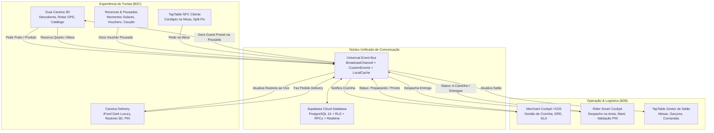

# 🏛️ MASTER ECOSYSTEM ARCHITECTURE & INTER-APP COMMUNICATION
## Caraíva Digital + TapTable + Delivery + Pousadas + Rider Cockpit + Merchant OS

> **Data de Emissão:** 20 de Outubro de 2026  
> **Versão:** 3.0.0-CONNECTED  
> **Status:** Arquitetura Aprovada & Pronta para Execução  
> **Ambiente:** Híbrido (Supabase Cloud PostgreSQL + Local/Cross-Tab Offline-First Event Bus)

---

## 1. Visão Geral do Ecossistema: O Que Temos Hoje

O ecossistema de Caraíva é composto por **6 produtos complementares** que atendem tanto o turista (B2C) quanto os comerciantes e prestadores de serviços locais (B2B):



---

## 2. Mapa dos Produtos e Seus Componentes no Código

| Produto | Objetivo Principal | Localização no Código | Tecnologias Chave |
| :--- | :--- | :--- | :--- |
| **Guia Caraíva** | Descoberta cultural, catálogo multi-nicho, geolocalização com rotas em ruas de areia e maré. | `caraiva-integration/src/screens/GuiaCaraivaApp.tsx`<br/>`src/components/guia/*` | MapLibre GL, React 19, Motion, GPS Geolocation |
| **Caraíva Delivery** | Experiência de pedido de comida estilo iFood Dark Luxury, seleção de adicionais, rastreio ao vivo 3D com PIN. | `caraiva-integration/src/components/delivery/*`<br/>`DeliveryLiveTracker.tsx`, `DeliveryCartDrawer.tsx` | Three.js WebGL, Tailwind v4, Audio Synthesis |
| **Reservas & Pousadas** | Reserva de suítes e mesas com base nos "Momentos Solares" (Pôr do sol, Samba), caução 100% revertida em consumação. | `src/components/guia/business-detail/CaraivaLivingBookingSection.tsx` | LocalStorage Presets, WhatsApp Concierge, Voucher Generator |
| **TapTable (NFC/Mesa)** | Sistema de mesas via NFC, comanda compartilhada, divisão instantânea de conta no Pix e gestão de garçons. | `taptable-app/src/*`<br/>`caraiva-integration/src/components/guia/table/` | Web NFC API, Pix Split Engine, Realtime |
| **Merchant Cockpit / KDS** | Painel operacional do lojista: Kanban KDS, SLA regressivo com alertas táteis/sonoros, DRE e controle de cardápio. | `src/components/partner/CaraivaUniversalBusinessApp.tsx`<br/>`CaraivaSpatialBusinessCockpit.tsx` | Kanban D&D, Web Audio API, Financial Metrics |
| **Rider Smart Cockpit** | Painel do entregador adaptado para ruas de areia, canoas e maré do Rio Caraíva, com verificação de PIN de 4 dígitos. | `src/services/riderDispatchService.ts`<br/>`src/components/rider/RiderAvailability.tsx` | Sand-Path Routing, Tide Telemetry, Offline Sync |

---

## 3. O Fluxo Unificado de Comunicação: Como Funciona na Prática

### Fluxo 1: Pedido Gastronômico (Guia ➔ Delivery ➔ KDS ➔ Rider ➔ Rastreio)

```
[1. Turista no Guia]
  │  Visualiza restaurante (ex: Boteco do Pará ou Caju Caraíva).
  │  Clica no prato (ex: Pastel de Arraia ou Moqueca de Peixe).
  │  Adiciona à Sacola Flutuante Dourada.
  ▼
[2. Checkout Integrado (Guia ou Delivery Drawer)]
  │  Turista clica em "Fechar Pedido".
  │  Informa Local: Se já tiver check-in em pousada, o campo vem AUTO-PREENCHIDO!
  │  Gera QR Code Pix instantâneo + Código de Segurança de 4 Dígitos (PIN: ex. 4812).
  ▼
[3. Barramento Unificado (Event Bus + Supabase)]
  │  1. Salva em `caraiva_active_delivery_order` no LocalStorage.
  │  2. Emite evento `caraiva:orders-updated` e mensagem em `caraiva_unified_orders_sync`.
  │  3. Registra na tabela `cd_orders` / `cd_order_lines` no Supabase.
  ▼
[4. Cozinha & Dono do Restaurante (Merchant KDS)]
  │  O KDS toca o alerta sonoro tátil de novo pedido.
  │  O card cai na coluna "NOVO" com SLA de 35 minutos.
  │  Dono clica "Aceitar e Preparar" ➔ Status vira "PREPARANDO".
  ▼
[5. Notificação Automática ao Entregador (Rider Cockpit)]
  │  Quando a cozinha aperta "Pronto", o Rider Cockpit apita para entregadores da zona.
  │  O entregador aceita ➔ Status vira "EM ROTA".
  │  O app calcula o tempo real de travessia considerando a tábua da maré.
  ▼
[6. Rastreio ao Vivo do Turista (Delivery Live Tracker)]
  │  O turista pode acompanhar em tempo real em qualquer tela!
  │  Aparece a Dynamic Island / Barra Flutuante com o status ativo e o PIN de 4 dígitos.
  │  Ao clicar, abre o mapa 3D com a posição do entregador e rota na areia.
  │  O entregador digita o PIN do turista para finalizar com sucesso!
```

---

### Fluxo 2: Reserva de Pousada / Mesa (Guia ➔ Pousada ➔ Guest Pass)

```
[1. Turista no Guia / Pousadas]
  │  Visualiza Pousada Casa da Praia ou Bangalôs do Luar.
  │  Seleciona a data de Check-in, Check-out e quantidade de hóspedes.
  ▼
[2. Reserva Garantida & Voucher]
  │  Paga sinal via Pix (50% ou caução com 100% de crédito revertido).
  │  O sistema gera um Voucher com Código de Confirmação (#RES-4421).
  ▼
[3. Emissão do "Guest Pass" (Sinergia Simbiótica!)]
  │  A pousada salva o hóspede no sistema.
  │  O navegador do turista recebe o token: `caraiva_guest_preset`:
  │  { "pousada": "Pousada Casa da Praia", "suite": "Suíte 03", "lat": -13.368, "lng": -39.112 }
  ▼
[4. Efeito Mágico no Delivery:]
  │  Mais tarde, quando o hóspede abrir o Guia ou Delivery para pedir comida à noite,
  │  o endereço de entrega já estará selecionado: "Pousada Casa da Praia — Suíte 03"!
  │  Zero esforço para digitar endereço em ruas sem CEP ou número!
```

---

## 4. Auditoria do Banco de Dados Supabase: O Que Temos e O Que Ajustar

### O Que Já Está Excelente no Banco:
1. **`cd_businesses`**: Tabela mestre com nichos válidos (`restaurante`, `pousada`, `passeio`, `mercado`), taxa de entrega e controle de publicação.
2. **`cd_offerings`**: Catálogo flexível que suporta pratos (`product`), quartos (`room`), expedições (`tour`) e mesas (`table`).
3. **`cd_orders` & `cd_order_lines`**: Estrutura atômica de pedidos com idempotência via `request_id` anti-duplicação.
4. **`cd_bookings`**: Bloqueio de datas/horários para pousadas e passeios com checagem de sobreposição (`starts_at`, `ends_at`, `seats`).
5. **RPC `caraiva_private.checkout(...)`**: Transação PostgreSQL blindada que consulta preços direto do servidor (o cliente nunca pode injetar preços adulterados).

### O Que Ajustamos e Habilitamos na Migração:
1. **Publicação Realtime do Supabase**:
   - `cd_orders` e `cd_bookings` adicionadas à publicação `supabase_realtime`.
2. **Coluna de Código PIN de Entrega**:
   - Coluna `delivery_pin text` na tabela `cd_orders` (código de 4 dígitos para confirmação de entrega segura contra fraudes).
3. **Tabela de Entregadores & Despacho (`cd_riders`)**:
   - Modelada para conectar o KDS do restaurante diretamente ao painel do entregador.
4. **Tabela de Mesas TapTable (`cd_tables`)**:
   - Conectar as mesas físicas e comandas abertas via NFC com as ordens unificadas.

---

## 5. Arquitetura de Segurança: Blindagem Contra Acessos Estranhos e Quedas

### Camada 1: Gatekeeper & Proteção de Acesso
- **Senha Mestre de Demonstração / Acesso Antecipado:** `135753` (implementada em `projectSecurityService.ts`).
- **Bloqueio de Rotas Privadas:** Rotas de gestão (`/business/*`, `/cockpit`, `/admin`) exigem autenticação do proprietário com conferência na tabela `cd_members`. Turistas comuns nunca visualizam dados financeiros (DRE, faturamento) de outros comerciantes.

### Camada 2: Proteção de Dados e RLS (Row Level Security)
- Todas as tabelas têm `ROW LEVEL SECURITY ENABLED`.
- **Turistas** só leem ofertas públicas e seus próprios pedidos (`customer_id = auth.uid()`).
- **Comerciantes** só leem e alteram pedidos da sua própria loja (`business_id = cd_members.business_id`).
- Funções críticas (`checkout`, `set_order_status`) rodam com `SECURITY DEFINER` em schema privado (`caraiva_private`), impedindo chamadas maliciosas diretas de clientes anônimos.

### Camada 3: Resiliência Contra Quedas da Aplicação (Zero-Crash Guarantee)
- **Defensive Storage Wrappers:** O `localStorage` é envolto em blocos `try/catch` com sanitização de JSON e limites de tamanho (evita estourar os 5MB do navegador).
- **WebGL Context Recovery:** O componente `CaraivaDelivery3DHero` e o mapa escutam os eventos `webglcontextlost` e `webglcontextrestored`, evitando a temida "tela branca" quando o celular esquenta ou a GPU é throttled.
- **Fail-Safe Offline Queue:** Se o Supabase cair ou o sinal 4G/Wi-Fi de Caraíva oscilar na praia, o pedido é armazenado na fila local do navegador e sincronizado via `BroadcastChannel` localmente, garantindo que o cliente nunca perca o pedido.
