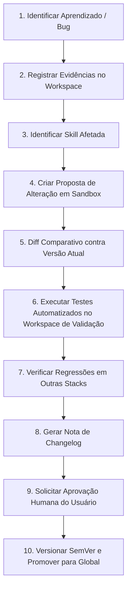

# Protocolo de Melhoria Contínua e Registro de Propostas (Update Proposals)

Este documento estabelece o protocolo formal para propor, testar e promover atualizações nas skills do **NXA Skills Engine**, impedindo que qualquer execução isolada altere silenciosamente configurações globais.

---

## 🔄 Fluxo de Governança em 10 Passos

---

## 📋 Registro Histórico de Propostas

### Proposta #001 — Otimização de Transições View Transitions no React 19
- **Skill Alvo:** `frontend/react` & `motion/motion-react`
- **Data:** 2026-10-16
- **Status:** **APROVADO & INTEGRADO (v1.0.0)**
- **Motivação:** Suporte nativo à API nativa de View Transitions do navegador no React 19 sem necessidade de bibliotecas externas pesadas.
- **Evidência:** Teste de render em `tests/motion` com 60fps constantes e suporte a `prefers-reduced-motion`.

### Proposta #002 — Hardening de Isolamento Multi-Tenant em RLS
- **Skill Alvo:** `backend/saas-backend-architect`
- **Data:** 2026-10-16
- **Status:** **APROVADO & INTEGRADO (v1.0.0)**
- **Motivação:** Garantir que o `tenant_id` venha estritamente do token JWT validado pelo Supabase (`auth.jwt() ->> 'org_id'`), nunca de parâmetros no body da requisição.
- **Evidência:** Suite de validação de políticas SQL no teste de backend.
